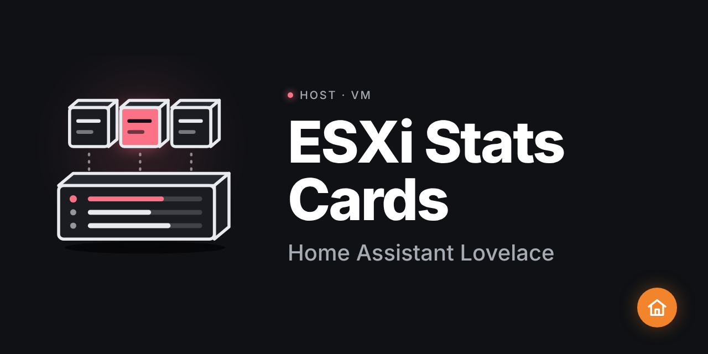

# ha-esxi-card



[](https://hacs.xyz)
[](https://github.com/HOMELAB-IA/ha-esxi-card/releases)
[](https://github.com/HOMELAB-IA/ha-esxi-card/actions)

Deux cartes Lovelace Home Assistant pour superviser un hôte ESXi et ses machines virtuelles.

> **Prérequis** : intégration [ESXi Stats](https://github.com/wxt9861/esxi_stats) installée via HACS.

## Cartes incluses

### `esxi-host-card`

Carte compacte + expandable pour un hôte ESXi. Affiche CPU (arc gauge 270°), mémoire (donut), nombre de VMs et uptime. Section détail repliable avec tous les attributs et bouton de redémarrage.

### `esxi-vm-card`

Carte compacte + expandable pour une machine virtuelle. Affiche CPU %, mémoire (donut), disque utilisé et snapshots. Section actions repliable : snapshot, démarrer, arrêter, redémarrer, console ESXi.

## Installation

### Via HACS (recommandé)

[](https://my.home-assistant.io/redirect/hacs_repository/?owner=HOMELAB-IA&repository=ha-esxi-card&category=plugin)

Ou manuellement :

1. Ouvrir HACS → **Frontend**
2. Cliquer les ⋮ → **Dépôts personnalisés**
3. Ajouter `https://github.com/HOMELAB-IA/ha-esxi-card` — catégorie **Dashboard**
4. Chercher **ESXi Card** et installer
5. Vider le cache du navigateur

### Installation manuelle

1. Télécharger [`esxi-card.js`](https://github.com/HOMELAB-IA/ha-esxi-card/releases/latest/download/esxi-card.js)
2. Copier dans `<config>/www/`
3. Dans HA → **Paramètres → Tableau de bord → Ressources**, ajouter `/local/esxi-card.js`
4. Vider le cache

## Configuration

### esxi-host-card

```yaml
type: custom:esxi-host-card
host_id: esxi_dell   # nom de l'hôte tel que défini dans l'intégration ESXi Stats
```

| Paramètre | Type | Requis | Description |
|---|---|---|---|
| `host_id` | `string` | ✅ | Identifiant de l'hôte dans ESXi Stats (ex. `esxi_dell`) |

### esxi-vm-card

```yaml
type: custom:esxi-vm-card
vm_id: nas_dc_2025            # identifiant de la VM dans ESXi Stats
disk_capacity_gb: 650         # optionnel — capacité disque totale en Go (défaut : 650)
esxi_console_url: https://esxi.homelab.local/ui   # optionnel — URL console ESXi
```

| Paramètre | Type | Requis | Description |
|---|---|---|---|
| `vm_id` | `string` | ✅ | Identifiant de la VM dans ESXi Stats |
| `disk_capacity_gb` | `number` | ❌ | Capacité disque totale en Go (défaut : 650) |
| `esxi_console_url` | `string` | ❌ | URL de la console web ESXi (affiche un bouton dans la section actions) |

## Dépendances

- [ESXi Stats](https://github.com/wxt9861/esxi_stats) — intégration HACS qui expose les entités `sensor.esxi_host_*` et `sensor.vm_*`
- Home Assistant ≥ 2024.1.0

## Licence

MIT
